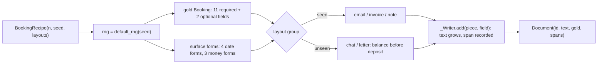

PR: [bhavya94/llm-vs-small-models-extraction#1](https://github.com/bhavya94/llm-vs-small-models-extraction/pull/1)

# Stack 1/8: booking schema and seeded generator

## Summary
The project compares an LLM, a token tagger and a small fine-tuned model on structured extraction. A fair
comparison needs documents with exact gold answers. This PR adds a strict `Booking` schema with 13 fields and a
seeded generator of fictional booking confirmations. Each document comes with its gold JSON and the character
span of every field value. The layouts form two groups. Models train on the three seen layouts (email, invoice,
note). The two unseen layouts (chat, letter) test whether a model learned the task or memorized the templates.

## How it works

- [`src/extraction_eval_lab/data/schema.py:9`](https://github.com/bhavya94/llm-vs-small-models-extraction/blob/a3e0e24d27e1a93a7efb77c7fe2beffd089deb48/src/extraction_eval_lab/data/schema.py#L9) lists the 13 fields in schema order. Every later PR scores against this list.
- [`src/extraction_eval_lab/data/schema.py:17`](https://github.com/bhavya94/llm-vs-small-models-extraction/blob/a3e0e24d27e1a93a7efb77c7fe2beffd089deb48/src/extraction_eval_lab/data/schema.py#L17) sets `extra="forbid"`. A prediction with an unknown key fails validation.
- [`src/extraction_eval_lab/data/schema.py:24`](https://github.com/bhavya94/llm-vs-small-models-extraction/blob/a3e0e24d27e1a93a7efb77c7fe2beffd089deb48/src/extraction_eval_lab/data/schema.py#L24) and [`schema.py:25`](https://github.com/bhavya94/llm-vs-small-models-extraction/blob/a3e0e24d27e1a93a7efb77c7fe2beffd089deb48/src/extraction_eval_lab/data/schema.py#L25) reject a zero guest count and a currency that is not a 3-letter code.
- [`src/extraction_eval_lab/data/generator.py:31`](https://github.com/bhavya94/llm-vs-small-models-extraction/blob/a3e0e24d27e1a93a7efb77c7fe2beffd089deb48/src/extraction_eval_lab/data/generator.py#L31) gives four date forms. Each form states the year and spells or year-orders the month, so no form is ambiguous.
- [`src/extraction_eval_lab/data/generator.py:37`](https://github.com/bhavya94/llm-vs-small-models-extraction/blob/a3e0e24d27e1a93a7efb77c7fe2beffd089deb48/src/extraction_eval_lab/data/generator.py#L37) gives three money forms: symbol, code first, code last.
- [`src/extraction_eval_lab/data/generator.py:43`](https://github.com/bhavya94/llm-vs-small-models-extraction/blob/a3e0e24d27e1a93a7efb77c7fe2beffd089deb48/src/extraction_eval_lab/data/generator.py#L43) defines `_Writer`. It records each span while it writes the text.
  The span is exact even when a value repeats. The email layout names the venue twice and tags only the first ([`src/extraction_eval_lab/data/generator.py:107`](https://github.com/bhavya94/llm-vs-small-models-extraction/blob/a3e0e24d27e1a93a7efb77c7fe2beffd089deb48/src/extraction_eval_lab/data/generator.py#L107)).
- [`src/extraction_eval_lab/data/generator.py:78`](https://github.com/bhavya94/llm-vs-small-models-extraction/blob/a3e0e24d27e1a93a7efb77c7fe2beffd089deb48/src/extraction_eval_lab/data/generator.py#L78) seeds one random generator per recipe. The same seed gives the same documents.
- [`src/extraction_eval_lab/data/generator.py:94`](https://github.com/bhavya94/llm-vs-small-models-extraction/blob/a3e0e24d27e1a93a7efb77c7fe2beffd089deb48/src/extraction_eval_lab/data/generator.py#L94) and [`generator.py:96`](https://github.com/bhavya94/llm-vs-small-models-extraction/blob/a3e0e24d27e1a93a7efb77c7fe2beffd089deb48/src/extraction_eval_lab/data/generator.py#L96) put the deposit 30 to 120 days before the event and the balance 3 to 20 days before.
- [`src/extraction_eval_lab/data/generator.py:154`](https://github.com/bhavya94/llm-vs-small-models-extraction/blob/a3e0e24d27e1a93a7efb77c7fe2beffd089deb48/src/extraction_eval_lab/data/generator.py#L154) and [`generator.py:170`](https://github.com/bhavya94/llm-vs-small-models-extraction/blob/a3e0e24d27e1a93a7efb77c7fe2beffd089deb48/src/extraction_eval_lab/data/generator.py#L170) are the unseen layouts. They state the balance before the deposit.
  An extractor that assigns values by position fails on them.
- [`src/extraction_eval_lab/data/generator.py:190`](https://github.com/bhavya94/llm-vs-small-models-extraction/blob/a3e0e24d27e1a93a7efb77c7fe2beffd089deb48/src/extraction_eval_lab/data/generator.py#L190) groups the layouts. `"all"` joins both groups for tests.
- [`tests/test_layers.py:29`](https://github.com/bhavya94/llm-vs-small-models-extraction/blob/a3e0e24d27e1a93a7efb77c7fe2beffd089deb48/tests/test_layers.py#L29) checks that each package imports only the packages below it. [`tests/test_layers.py:39`](https://github.com/bhavya94/llm-vs-small-models-extraction/blob/a3e0e24d27e1a93a7efb77c7fe2beffd089deb48/tests/test_layers.py#L39) checks that only the CLI prints.

## Decision log
| Decision | Options considered | Chosen | Why |
|---|---|---|---|
| Data source | Real documents; a generator | Generator | Gold is exact, spans come free, and no private data enters a public repo |
| Test split | Random split; held-out layouts | Held-out layouts | A random split shares templates and would reward memorizing them |
| Surface forms | One form per type; several | Several, all unambiguous | Extractors must normalize, not copy. Ambiguous forms belong to the adversarial set (Stack 6/8) |
| Spans | Search the text afterwards; record while writing | Record while writing | A search can match the wrong copy of a repeated value |
| Schema strictness | Lenient; `extra="forbid"` | Forbid | A sloppy extractor should fail loudly, not pass with extra keys |

Revisit the layout split if a model scores high on unseen layouts. Two unseen layouts may then be too few.

## Cost & risk
Generation is pure Python and runs no model. The risk is coverage. Three seen layouts are a narrow training
distribution. The name pools are small (20 first names, 17 last names), so test names also appear in training.
That is acceptable here because the test targets layout, not names. Rollback is a revert: no later data depends on stored files.

## Open questions
- Should the unseen group have more than two layouts? Two layouts give a coarse measure of transfer.
- The `metrics-from-scratch` dependency is not pinned to a commit here ([`pyproject.toml:10`](https://github.com/bhavya94/llm-vs-small-models-extraction/blob/a3e0e24d27e1a93a7efb77c7fe2beffd089deb48/pyproject.toml#L10)). Stack 7/8 pins it.
