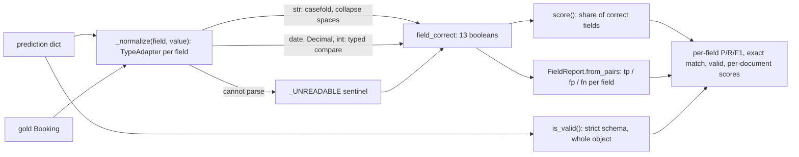

PR: [bhavya94/llm-vs-small-models-extraction#2](https://github.com/bhavya94/llm-vs-small-models-extraction/pull/2)

# Stack 2/8: per-field scorer and a rule-based baseline

## Summary
Every extractor in this project needs one shared scorer. This PR adds it. `score(predicted, gold)` is a pure
function that returns the share of correct fields, so it can also serve as a training reward. `FieldReport`
turns many documents into per-field precision, recall and F1, plus exact match and schema validity. The PR also
adds a rule-based extractor as the free baseline. On 100 test documents per layout group (the CLI default, [`src/extraction_eval_lab/cli.py:42`](https://github.com/bhavya94/llm-vs-small-models-extraction/blob/4903e279423b47f1430c948fe292a339b607114e/src/extraction_eval_lab/cli.py#L42)), the rules are perfect on
seen layouts (F1 1.0, exact match 1.0). On unseen layouts, exact match is 0.00.

## How it works

- [`src/extraction_eval_lab/evaluation/scorer.py:14`](https://github.com/bhavya94/llm-vs-small-models-extraction/blob/4903e279423b47f1430c948fe292a339b607114e/src/extraction_eval_lab/evaluation/scorer.py#L14) builds one pydantic `TypeAdapter` per field from the schema. The scorer reuses the schema's types instead of copying them.
- [`src/extraction_eval_lab/evaluation/scorer.py:17`](https://github.com/bhavya94/llm-vs-small-models-extraction/blob/4903e279423b47f1430c948fe292a339b607114e/src/extraction_eval_lab/evaluation/scorer.py#L17) normalizes one value. "2027-03-04" equals `date(2027, 3, 4)` and "1700" equals `Decimal("1700.00")`.
  A currency symbol inside an amount stays wrong. Leniency stops at type coercion.
- [`src/extraction_eval_lab/evaluation/scorer.py:30`](https://github.com/bhavya94/llm-vs-small-models-extraction/blob/4903e279423b47f1430c948fe292a339b607114e/src/extraction_eval_lab/evaluation/scorer.py#L30) compares strings without case and with collapsed whitespace.
- [`src/extraction_eval_lab/evaluation/scorer.py:36`](https://github.com/bhavya94/llm-vs-small-models-extraction/blob/4903e279423b47f1430c948fe292a339b607114e/src/extraction_eval_lab/evaluation/scorer.py#L36) returns one boolean per field. An absent optional field is right when gold is absent too.
- [`src/extraction_eval_lab/evaluation/scorer.py:43`](https://github.com/bhavya94/llm-vs-small-models-extraction/blob/4903e279423b47f1430c948fe292a339b607114e/src/extraction_eval_lab/evaluation/scorer.py#L43) is the pure `score()`. An empty or missing prediction scores 0.
- [`src/extraction_eval_lab/evaluation/scorer.py:51`](https://github.com/bhavya94/llm-vs-small-models-extraction/blob/4903e279423b47f1430c948fe292a339b607114e/src/extraction_eval_lab/evaluation/scorer.py#L51) checks validity separately. An extra key fails validity but costs no field ([`tests/test_scorer.py:35`](https://github.com/bhavya94/llm-vs-small-models-extraction/blob/4903e279423b47f1430c948fe292a339b607114e/tests/test_scorer.py#L35)).
- [`src/extraction_eval_lab/evaluation/scorer.py:89`](https://github.com/bhavya94/llm-vs-small-models-extraction/blob/4903e279423b47f1430c948fe292a339b607114e/src/extraction_eval_lab/evaluation/scorer.py#L89) to [`scorer.py:94`](https://github.com/bhavya94/llm-vs-small-models-extraction/blob/4903e279423b47f1430c948fe292a339b607114e/src/extraction_eval_lab/evaluation/scorer.py#L94) count a wrong value as both a false positive and a false negative.
  A value stated where gold has none is a false positive only.
- [`src/extraction_eval_lab/evaluation/scorer.py:99`](https://github.com/bhavya94/llm-vs-small-models-extraction/blob/4903e279423b47f1430c948fe292a339b607114e/src/extraction_eval_lab/evaluation/scorer.py#L99) gives F1 1.0 when a field has nothing to count. An optional field that never appears and is never predicted is not an error.
- [`src/extraction_eval_lab/evaluation/scorer.py:101`](https://github.com/bhavya94/llm-vs-small-models-extraction/blob/4903e279423b47f1430c948fe292a339b607114e/src/extraction_eval_lab/evaluation/scorer.py#L101) keeps `score()` per document for paired comparisons later.
- [`src/extraction_eval_lab/extractors/rules.py:14`](https://github.com/bhavya94/llm-vs-small-models-extraction/blob/4903e279423b47f1430c948fe292a339b607114e/src/extraction_eval_lab/extractors/rules.py#L14) holds one regular expression per field, written against the seen layouts' wording.
- [`src/extraction_eval_lab/extractors/rules.py:49`](https://github.com/bhavya94/llm-vs-small-models-extraction/blob/4903e279423b47f1430c948fe292a339b607114e/src/extraction_eval_lab/extractors/rules.py#L49) and [`rules.py:50`](https://github.com/bhavya94/llm-vs-small-models-extraction/blob/4903e279423b47f1430c948fe292a339b607114e/src/extraction_eval_lab/extractors/rules.py#L50) assign dates and amounts by order: event, deposit, balance.
  This is the rule that breaks on unseen layouts, which state the balance first.

## Results
| Field group | Seen F1 | Unseen F1 |
|---|---|---|
| booker_email, currency | 1.0 | 1.0 |
| deposit_due | 1.0 | 0.60 |
| the other 10 fields | 1.0 | 0.0 |
| exact match | 1.0 | 0.00 |

The email and currency patterns do not depend on wording, so they transfer. The other patterns need phrases
like "Dear" or "Client:", which the unseen layouts never use. `deposit_due` is right on the chat layout only.
Chat states the dates as balance, deposit, event, so the second date is the deposit date by chance.

## Decision log
| Decision | Options considered | Chosen | Why |
|---|---|---|---|
| Match rule | Exact string; fuzzy string; typed values | Typed values | Fair to formats the schema accepts, strict about wrong values |
| Wrong value | Count as FP only; FP and FN | FP and FN | A wrong value both asserts something false and misses the truth |
| Validity | Fold into the score; separate metric | Separate | One extra key should not zero a document that has every field right |
| Score shape | Report object only; pure function too | Pure function too | A pure `score()` can serve as a reward for later training |
| Baseline | None; regular expressions | Regular expressions | Every model must beat a free baseline on the same documents |

## Cost & risk
The scorer and rules run in pure Python with no model. The main risk is the scorer itself. A lenient scorer
would hide errors in every later PR. [`tests/test_scorer.py:23`](https://github.com/bhavya94/llm-vs-small-models-extraction/blob/4903e279423b47f1430c948fe292a339b607114e/tests/test_scorer.py#L23) pins one wrong field to one lost field. Rollback is a revert.

## Open questions
- Should names allow small typos? The scorer says no today. A relaxed match would need its own metric, not a change to this one.
