PR: [bhavya94/llm-vs-small-models-extraction#3](https://github.com/bhavya94/llm-vs-small-models-extraction/pull/3)

# Stack 3/8: a BIO token tagger

## Summary
This PR adds the classic named-entity approach to extraction. A `distilbert-base-cased` encoder labels each
token as the beginning (B) or inside (I) of a field, or outside (O). The labels come from the generator's spans,
so training needs no annotation. After 3 epochs on 600 seen documents, the tagger is perfect on seen layouts.
On unseen layouts, exact match and valid JSON are both 0.00. Some fields transfer well and others fail completely.

## How it works

```mermaid
flowchart LR
  D["Document text + spans"] --> T["tokenizer: ids + character offsets"]
  T --> L["labels_from_spans: B / I / O per token, -100 on special tokens"]
  L --> TR["TaggerTraining.run: AdamW, pad every batch to 192, CPU"]
  TR --> M["saved model, name hashed from recipe + texts"]
  M --> TG["Tagger.extract: argmax label per token"]
  TG --> SP["spans_from_labels: first span per field"]
  SP --> PF["parse_field: date, amount, int or string"]
  PF --> P["prediction dict, 13 keys"]
```

- [`src/extraction_eval_lab/extractors/tagger.py:21`](https://github.com/bhavya94/llm-vs-small-models-extraction/blob/31e29d5aff0cbc7a87416aaca6b0313a6c24c921/src/extraction_eval_lab/extractors/tagger.py#L21) defines 27 labels: O plus a B and an I for each of the 13 fields.
- [`src/extraction_eval_lab/extractors/tagger.py:30`](https://github.com/bhavya94/llm-vs-small-models-extraction/blob/31e29d5aff0cbc7a87416aaca6b0313a6c24c921/src/extraction_eval_lab/extractors/tagger.py#L30) turns character spans into token labels. A token that overlaps a span gets that field's label.
- [`src/extraction_eval_lab/extractors/tagger.py:43`](https://github.com/bhavya94/llm-vs-small-models-extraction/blob/31e29d5aff0cbc7a87416aaca6b0313a6c24c921/src/extraction_eval_lab/extractors/tagger.py#L43) turns labels back into spans. It keeps only the first span per field.
  A stray I with no B still starts a span, so one wrong B does not lose the field.
- [`src/extraction_eval_lab/extractors/tagger.py:72`](https://github.com/bhavya94/llm-vs-small-models-extraction/blob/31e29d5aff0cbc7a87416aaca6b0313a6c24c921/src/extraction_eval_lab/extractors/tagger.py#L72) pads every batch to 192 tokens. The longest generated document is 154 tokens.
- [`src/extraction_eval_lab/extractors/tagger.py:76`](https://github.com/bhavya94/llm-vs-small-models-extraction/blob/31e29d5aff0cbc7a87416aaca6b0313a6c24c921/src/extraction_eval_lab/extractors/tagger.py#L76) trains on the CPU. The comment above it gives the reason and the speed.
- [`src/extraction_eval_lab/extractors/tagger.py:79`](https://github.com/bhavya94/llm-vs-small-models-extraction/blob/31e29d5aff0cbc7a87416aaca6b0313a6c24c921/src/extraction_eval_lab/extractors/tagger.py#L79) names the saved model by a hash of the recipe and the training texts. [`tagger.py:87`](https://github.com/bhavya94/llm-vs-small-models-extraction/blob/31e29d5aff0cbc7a87416aaca6b0313a6c24c921/src/extraction_eval_lab/extractors/tagger.py#L87) reuses it, so a rerun skips training.
- [`src/extraction_eval_lab/extractors/tagger.py:125`](https://github.com/bhavya94/llm-vs-small-models-extraction/blob/31e29d5aff0cbc7a87416aaca6b0313a6c24c921/src/extraction_eval_lab/extractors/tagger.py#L125) runs inference on MPS when it is available. Training stays on CPU.
- [`src/extraction_eval_lab/extractors/tagger.py:139`](https://github.com/bhavya94/llm-vs-small-models-extraction/blob/31e29d5aff0cbc7a87416aaca6b0313a6c24c921/src/extraction_eval_lab/extractors/tagger.py#L139) parses each span into the schema's type.
- [`src/extraction_eval_lab/extractors/parsing.py:33`](https://github.com/bhavya94/llm-vs-small-models-extraction/blob/31e29d5aff0cbc7a87416aaca6b0313a6c24c921/src/extraction_eval_lab/extractors/parsing.py#L33) is that parser. This PR moves it out of the rules, so the rules and the tagger normalize the same way.
- [`src/extraction_eval_lab/__init__.py:6`](https://github.com/bhavya94/llm-vs-small-models-extraction/blob/31e29d5aff0cbc7a87416aaca6b0313a6c24c921/src/extraction_eval_lab/__init__.py#L6) turns off tokenizer threads. The Rust thread pool can deadlock MPS graph compilation.

## Results
Per-field F1 on 100 unseen test documents. Seen layouts score 1.0 on every field.

| Field | Unseen F1 | Field | Unseen F1 |
|---|---|---|---|
| booker_name | 0.938 | currency | 1.0 |
| booker_email | 0.560 | deposit_amount | 0.0 |
| venue_name | 0.854 | deposit_due | 0.145 |
| venue_city | 0.940 | balance_amount | 0.0 |
| event_date | 0.000 | balance_due | 0.0 |
| guest_count | 0.739 | caterer_name | 1.0 |
| cancellation_days | 0.718 | exact match / valid JSON | 0.00 / 0.00 |

Names, venues and the caterer transfer, because their tokens look the same in any layout. Dates and amounts fail.
A likely cause is position: in seen layouts the event date comes first and the deposit precedes the balance.
The unseen layouts reverse that order. If so, the tagger learned the order, not the meaning of "deposit" or "balance".
Valid JSON is 0.00 because every unseen prediction misses or garbles at least one required field.
Inference runs on MPS, the M1 GPU. It takes 0.0188 s per seen document and 0.0153 s per unseen document.

## Decision log
| Decision | Options considered | Chosen | Why |
|---|---|---|---|
| Labels | Hand annotation; spans from the generator | Generator spans | Exact and free. [`tests/test_tagger.py:15`](https://github.com/bhavya94/llm-vs-small-models-extraction/blob/31e29d5aff0cbc7a87416aaca6b0313a6c24c921/tests/test_tagger.py#L15) tests the round trip |
| Padding | Per batch; fixed 192 | Fixed 192 | On MPS each new shape compiles a graph. Variable shapes took memory to 5.9 GB |
| Training device | MPS; CPU | CPU | MPS thrashed on the 8 GB laptop. CPU runs 3 epochs in about 2.5 minutes |
| Inference device | CPU; MPS | MPS | The memory problem hit training only. Inference measured about 0.02 s per document |
| Span choice | Longest span; first span | First span | Simple and stable; repeated mentions come after the first in seen layouts |
| Parsing | Tagger-specific; shared with rules | Shared | Score differences then come from finding spans, not from parsing |

## Cost & risk
Training takes about 2.5 minutes on CPU at 1.35 s per step. Scoring 200 test documents on MPS takes a few seconds. The saved model lives in `.cache/models/`.
The hash covers the texts but not the spans. A generator change that moves spans but keeps the text would reuse a stale model.

## Open questions
- Would training on more layouts fix the date and amount fields? That would test the position explanation directly.
