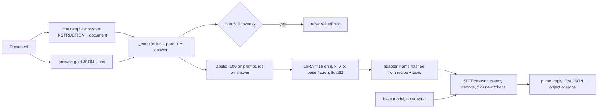

PR: [bhavya94/llm-vs-small-models-extraction#4](https://github.com/bhavya94/llm-vs-small-models-extraction/pull/4)

# Stack 4/8: LoRA fine-tuning of a small instruct model

## Summary
This PR asks whether a tiny generative model can learn to write the booking JSON. It fine-tunes
SmolLM2-135M-Instruct with LoRA on 600 seen documents for 2 epochs. The base model scores 0.00 exact match and
0.00 valid JSON on both layout groups. The tuned model reaches 0.94 exact match and 0.98 valid JSON on seen
layouts. On unseen layouts it writes valid JSON 75% of the time, but exact match stays at 0.00.

## How it works

- [`src/extraction_eval_lab/extractors/sft.py:24`](https://github.com/bhavya94/llm-vs-small-models-extraction/blob/a19b809241576bd1aea53fb78a810a096d8f4beb/src/extraction_eval_lab/extractors/sft.py#L24) gives the instruction: exact keys, ISO dates, two-decimal amounts, null for absent fields.
- [`src/extraction_eval_lab/extractors/parsing.py:45`](https://github.com/bhavya94/llm-vs-small-models-extraction/blob/a19b809241576bd1aea53fb78a810a096d8f4beb/src/extraction_eval_lab/extractors/parsing.py#L45) takes the first JSON object in the reply. No object, or bad JSON, gives `None`.
  It lives in the shared parsing module, so the LLM extractor in Stack 5/8 reuses it without importing torch.
- [`src/extraction_eval_lab/extractors/sft.py:47`](https://github.com/bhavya94/llm-vs-small-models-extraction/blob/a19b809241576bd1aea53fb78a810a096d8f4beb/src/extraction_eval_lab/extractors/sft.py#L47) sets `max_length` to 512. Prompt plus answer reaches about 450 tokens.
- [`src/extraction_eval_lab/extractors/sft.py:65`](https://github.com/bhavya94/llm-vs-small-models-extraction/blob/a19b809241576bd1aea53fb78a810a096d8f4beb/src/extraction_eval_lab/extractors/sft.py#L65) to [`sft.py:68`](https://github.com/bhavya94/llm-vs-small-models-extraction/blob/a19b809241576bd1aea53fb78a810a096d8f4beb/src/extraction_eval_lab/extractors/sft.py#L68) load the base in float32 and add LoRA adapters to the four attention projections.
- [`src/extraction_eval_lab/extractors/sft.py:70`](https://github.com/bhavya94/llm-vs-small-models-extraction/blob/a19b809241576bd1aea53fb78a810a096d8f4beb/src/extraction_eval_lab/extractors/sft.py#L70) gives the optimizer only the trainable adapter weights.
- [`src/extraction_eval_lab/extractors/sft.py:97`](https://github.com/bhavya94/llm-vs-small-models-extraction/blob/a19b809241576bd1aea53fb78a810a096d8f4beb/src/extraction_eval_lab/extractors/sft.py#L97) masks the prompt with -100. The loss covers only the answer, because the prompt is context, not a target.
- [`src/extraction_eval_lab/extractors/sft.py:95`](https://github.com/bhavya94/llm-vs-small-models-extraction/blob/a19b809241576bd1aea53fb78a810a096d8f4beb/src/extraction_eval_lab/extractors/sft.py#L95) raises on an overlong pair. Truncation would cut off the answer the model must learn.
- [`src/extraction_eval_lab/extractors/sft.py:63`](https://github.com/bhavya94/llm-vs-small-models-extraction/blob/a19b809241576bd1aea53fb78a810a096d8f4beb/src/extraction_eval_lab/extractors/sft.py#L63) explains the float32 choice on the training load. [`sft.py:110`](https://github.com/bhavya94/llm-vs-small-models-extraction/blob/a19b809241576bd1aea53fb78a810a096d8f4beb/src/extraction_eval_lab/extractors/sft.py#L110) loads float32 for inference too.
- [`src/extraction_eval_lab/extractors/sft.py:117`](https://github.com/bhavya94/llm-vs-small-models-extraction/blob/a19b809241576bd1aea53fb78a810a096d8f4beb/src/extraction_eval_lab/extractors/sft.py#L117) decodes greedily, so a rerun gives the same output.
- [`src/extraction_eval_lab/cli.py:53`](https://github.com/bhavya94/llm-vs-small-models-extraction/blob/a19b809241576bd1aea53fb78a810a096d8f4beb/src/extraction_eval_lab/cli.py#L53) scores the base and the tuned model on the same test documents.

## Results
| Metric | Base, seen | Base, unseen | Tuned, seen | Tuned, unseen |
|---|---|---|---|---|
| exact match | 0.00 | 0.00 | 0.94 | 0.00 |
| valid JSON | 0.00 | 0.00 | 0.98 | 0.75 |

The tuned model's unseen per-field F1 varies by field. venue_city (0.974), currency (0.974) and booker_name (0.810)
transfer. deposit_amount (0.431), event_date (0.154) and balance_due (0.041) do not. The pattern matches the
tagger in Stack 3/8. Fields that keep their look across layouts transfer. Fields that depend on order fail.

## Decision log
| Decision | Options considered | Chosen | Why |
|---|---|---|---|
| Tuning method | Full fine-tune; LoRA | LoRA, rank 16 | Few trainable weights keep memory low on an 8 GB laptop |
| Loss | Whole sequence; answer only | Answer only | Prompt tokens are not targets. Training on them wastes signal |
| Weight dtype | bfloat16 as stored; float32 | float32 | The M1 CPU has no fast bfloat16 math. One step took about 230 s in bfloat16 and 4.1 s in float32 |
| Length limit | 448 with truncation; 512 and raise | 512 and raise | At 448, truncation silently cut answers. Now an overlong pair stops the run |
| Baseline | Tuned only; base and tuned | Both | The base score shows what the tuning added |

## Cost & risk
Training runs 300 steps (150 batches of 4, 2 epochs). At 4.1 s per step, that is about 20 minutes on CPU.
The run saves the adapter in `.cache/models/`, so a rerun skips training. Inference runs on CPU in float32. It takes 4.5 s per document tuned and 5.4 s base.
Scoring both models on 200 test documents therefore takes about 33 minutes.
Answers near 220 tokens would hit `max_new_tokens` and return invalid JSON ([`src/extraction_eval_lab/extractors/sft.py:106`](https://github.com/bhavya94/llm-vs-small-models-extraction/blob/a19b809241576bd1aea53fb78a810a096d8f4beb/src/extraction_eval_lab/extractors/sft.py#L106)).

## Open questions
- Is the drop on unseen layouts a model-size limit or a data limit? Training on more layouts at the same size would separate the two.
