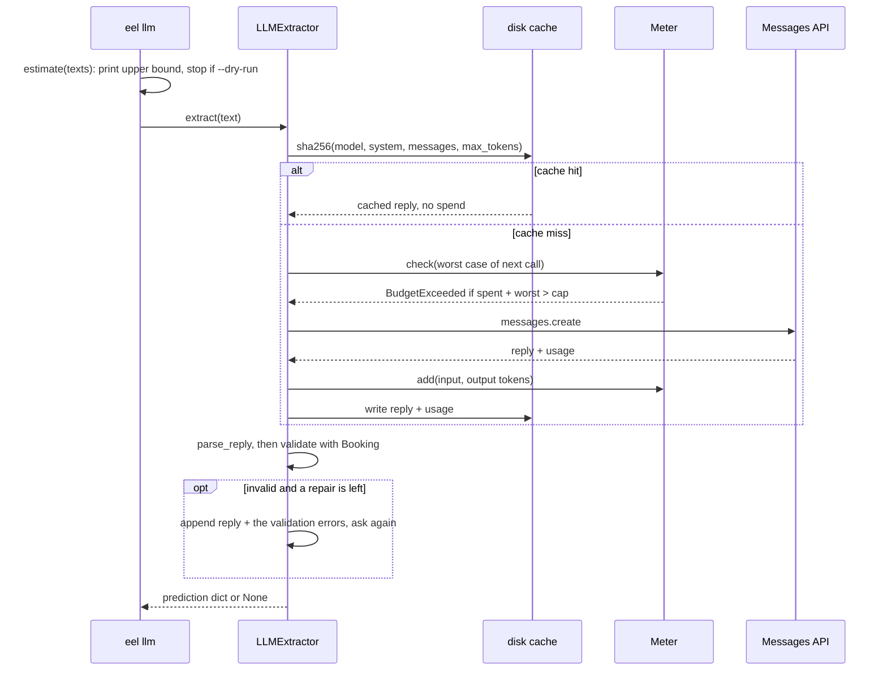

PR: [bhavya94/llm-vs-small-models-extraction#5](https://github.com/bhavya94/llm-vs-small-models-extraction/pull/5)

# Stack 5/8: an LLM extractor with validation, a cache and a budget

## Summary
This PR adds the third kind of extractor: a hosted LLM, Claude Haiku 4.5. The system prompt carries the
schema as JSON Schema. The extractor validates each reply against the strict schema and allows one repair. A disk
cache makes every rerun free, and a hard cap refuses any call that could pass the budget. On 100 test documents
per layout group, the LLM is perfect on both seen and unseen layouts (exact match 1.0). The 200 documents cost $0.32.

## How it works

- [`src/extraction_eval_lab/extractors/llm.py:23`](https://github.com/bhavya94/llm-vs-small-models-extraction/blob/59d4c8686731005c4ad349624e213e7f545d8122/src/extraction_eval_lab/extractors/llm.py#L23) puts the pydantic JSON Schema in the system prompt. The model sees the same contract the scorer enforces.
- [`src/extraction_eval_lab/extractors/llm.py:21`](https://github.com/bhavya94/llm-vs-small-models-extraction/blob/59d4c8686731005c4ad349624e213e7f545d8122/src/extraction_eval_lab/extractors/llm.py#L21) imports `parse_reply` from the shared parsing module. The API path never imports torch.
- [`src/extraction_eval_lab/extractors/llm.py:71`](https://github.com/bhavya94/llm-vs-small-models-extraction/blob/59d4c8686731005c4ad349624e213e7f545d8122/src/extraction_eval_lab/extractors/llm.py#L71) to [`llm.py:80`](https://github.com/bhavya94/llm-vs-small-models-extraction/blob/59d4c8686731005c4ad349624e213e7f545d8122/src/extraction_eval_lab/extractors/llm.py#L80) run the repair loop. A failed reply goes back with the exact validation errors.
- [`src/extraction_eval_lab/extractors/llm.py:76`](https://github.com/bhavya94/llm-vs-small-models-extraction/blob/59d4c8686731005c4ad349624e213e7f545d8122/src/extraction_eval_lab/extractors/llm.py#L76) counts documents that needed a repair, separately from API calls.
- [`src/extraction_eval_lab/extractors/llm.py:85`](https://github.com/bhavya94/llm-vs-small-models-extraction/blob/59d4c8686731005c4ad349624e213e7f545d8122/src/extraction_eval_lab/extractors/llm.py#L85) keys the cache on the whole request. A changed prompt or model never reuses an old reply.
- [`src/extraction_eval_lab/extractors/llm.py:87`](https://github.com/bhavya94/llm-vs-small-models-extraction/blob/59d4c8686731005c4ad349624e213e7f545d8122/src/extraction_eval_lab/extractors/llm.py#L87) returns a cached reply before the budget check, so cached work never counts against the cap.
- [`src/extraction_eval_lab/extractors/llm.py:46`](https://github.com/bhavya94/llm-vs-small-models-extraction/blob/59d4c8686731005c4ad349624e213e7f545d8122/src/extraction_eval_lab/extractors/llm.py#L46) checks the worst case before each call: estimated input plus every output token.
- [`src/extraction_eval_lab/extractors/llm.py:92`](https://github.com/bhavya94/llm-vs-small-models-extraction/blob/59d4c8686731005c4ad349624e213e7f545d8122/src/extraction_eval_lab/extractors/llm.py#L92) adds the real token counts from the response after each call.
- [`src/extraction_eval_lab/extractors/llm.py:110`](https://github.com/bhavya94/llm-vs-small-models-extraction/blob/59d4c8686731005c4ad349624e213e7f545d8122/src/extraction_eval_lab/extractors/llm.py#L110) estimates a whole run. It assumes 3 characters per token, full output length, and repairs on 20% of documents.
- [`src/extraction_eval_lab/cli.py:79`](https://github.com/bhavya94/llm-vs-small-models-extraction/blob/59d4c8686731005c4ad349624e213e7f545d8122/src/extraction_eval_lab/cli.py#L79) prints the estimate before any call, and [`cli.py:81`](https://github.com/bhavya94/llm-vs-small-models-extraction/blob/59d4c8686731005c4ad349624e213e7f545d8122/src/extraction_eval_lab/cli.py#L81) stops there with `--dry-run`.
- [`src/extraction_eval_lab/cli.py:85`](https://github.com/bhavya94/llm-vs-small-models-extraction/blob/59d4c8686731005c4ad349624e213e7f545d8122/src/extraction_eval_lab/cli.py#L85) imports the SDK only on a paid run. Tests pass a fake client and never call the API ([`tests/test_llm.py:13`](https://github.com/bhavya94/llm-vs-small-models-extraction/blob/59d4c8686731005c4ad349624e213e7f545d8122/tests/test_llm.py#L13)).

## Decision log
| Decision | Options considered | Chosen | Why |
|---|---|---|---|
| Schema delivery | Field list in prose; JSON Schema in the prompt | JSON Schema | One source of truth: the same pydantic model the scorer uses |
| Invalid replies | Score as is; retry blind; repair with errors | One repair with errors | The errors tell the model what to fix. One round bounds the cost |
| Cache | None; in memory; on disk by request hash | On disk | Reruns and later PRs reuse paid replies at no cost |
| Budget | Track only; refuse past the cap | Refuse on the worst case | A bug in a loop cannot spend more than the cap |
| Client | Built inside; passed in | Passed in | Tests use a fake client, so the test suite is free and offline |

## Cost & risk
200 documents cost $0.32, about $0.0016 per document. The CLI defaults are $1 and $5 per million input and
output tokens, with a $10 cap ([`src/extraction_eval_lab/cli.py:130`](https://github.com/bhavya94/llm-vs-small-models-extraction/blob/59d4c8686731005c4ad349624e213e7f545d8122/src/extraction_eval_lab/cli.py#L130)). The cap uses an estimate of input tokens
(characters divided by 3). If real input runs longer, one call can pass the cap by a small amount.
The CLI prints the repair count, but the results above do not include it.

## Open questions
- The request sets no temperature, so the API default applies. The cache hides any variation between runs. Should the extractor set temperature 0?
- A perfect score on both groups leaves no headroom. Stack 6/8 adds harder documents to separate the extractors.
