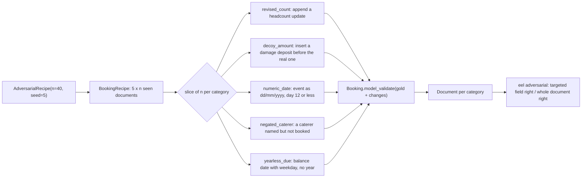

PR: [bhavya94/llm-vs-small-models-extraction#6](https://github.com/bhavya94/llm-vs-small-models-extraction/pull/6)

# Stack 6/8: five adversarial categories

## Summary
After Stack 5/8, the LLM is perfect on both layout groups. The clean test set can no longer separate it from
the others. This PR adds harder documents. Each one is a seen-layout document with one targeted change, and its gold
answer changes to match. The five categories copy ways extraction fails on real documents: revisions, decoys,
ambiguous dates, negation and missing years. The rules and the tagger fail almost every case. The SFT model
handles some. The LLM is perfect again, so this set cannot rank stronger models.

## How it works

- [`src/extraction_eval_lab/data/adversarial.py:16`](https://github.com/bhavya94/llm-vs-small-models-extraction/blob/afd68f7fed494515b93ee2065f65e5114051000e/src/extraction_eval_lab/data/adversarial.py#L16) maps each category to its targeted field and a one-line description.
- [`src/extraction_eval_lab/data/adversarial.py:25`](https://github.com/bhavya94/llm-vs-small-models-extraction/blob/afd68f7fed494515b93ee2065f65e5114051000e/src/extraction_eval_lab/data/adversarial.py#L25) edits text through the generator's spans. The edit lands exactly on the targeted value.
- [`src/extraction_eval_lab/data/adversarial.py:79`](https://github.com/bhavya94/llm-vs-small-models-extraction/blob/afd68f7fed494515b93ee2065f65e5114051000e/src/extraction_eval_lab/data/adversarial.py#L79) builds the base documents from seed 5. Training uses seed 1 and the clean tests use seed 3.
- [`src/extraction_eval_lab/data/adversarial.py:85`](https://github.com/bhavya94/llm-vs-small-models-extraction/blob/afd68f7fed494515b93ee2065f65e5114051000e/src/extraction_eval_lab/data/adversarial.py#L85) builds each new gold through `Booking.model_validate`. A bad change fails at once.
  [`tests/test_adversarial.py:11`](https://github.com/bhavya94/llm-vs-small-models-extraction/blob/afd68f7fed494515b93ee2065f65e5114051000e/tests/test_adversarial.py#L11) checks that every gold validates.
- [`src/extraction_eval_lab/cli.py:102`](https://github.com/bhavya94/llm-vs-small-models-extraction/blob/afd68f7fed494515b93ee2065f65e5114051000e/src/extraction_eval_lab/cli.py#L102) reuses the cached tagger and SFT models from Stacks 3/8 and 4/8. This command trains nothing new.
- [`src/extraction_eval_lab/cli.py:105`](https://github.com/bhavya94/llm-vs-small-models-extraction/blob/afd68f7fed494515b93ee2065f65e5114051000e/src/extraction_eval_lab/cli.py#L105) adds the LLM only with `--llm`, because that path costs money.
  [`cli.py:112`](https://github.com/bhavya94/llm-vs-small-models-extraction/blob/afd68f7fed494515b93ee2065f65e5114051000e/src/extraction_eval_lab/cli.py#L112) prints a dollar estimate before the first paid call.
- [`src/extraction_eval_lab/cli.py:123`](https://github.com/bhavya94/llm-vs-small-models-extraction/blob/afd68f7fed494515b93ee2065f65e5114051000e/src/extraction_eval_lab/cli.py#L123) and [`cli.py:124`](https://github.com/bhavya94/llm-vs-small-models-extraction/blob/afd68f7fed494515b93ee2065f65e5114051000e/src/extraction_eval_lab/cli.py#L124) report two numbers per cell. The first is the targeted field. The second is the whole document.
  The second number catches an edit that breaks a field other than the target.

## The five categories
1. **revised_count** ([`src/extraction_eval_lab/data/adversarial.py:30`](https://github.com/bhavya94/llm-vs-small-models-extraction/blob/afd68f7fed494515b93ee2065f65e5114051000e/src/extraction_eval_lab/data/adversarial.py#L30)). A later line changes the headcount, and the new number is right.
   Real bookings get amended. An extractor that keeps the first mention returns the stale value.
2. **decoy_amount** ([`src/extraction_eval_lab/data/adversarial.py:36`](https://github.com/bhavya94/llm-vs-small-models-extraction/blob/afd68f7fed494515b93ee2065f65e5114051000e/src/extraction_eval_lab/data/adversarial.py#L36)). A refundable damage deposit appears just before the booking deposit.
   Gold does not change. An extractor that takes the first amount, or the first "deposit", picks the decoy.
3. **numeric_date** ([`src/extraction_eval_lab/data/adversarial.py:45`](https://github.com/bhavya94/llm-vs-small-models-extraction/blob/afd68f7fed494515b93ee2065f65e5114051000e/src/extraction_eval_lab/data/adversarial.py#L45)). The event date becomes dd/mm/yyyy, and a header states the convention.
   The day is 12 or less, so both readings form a real date. Only the stated convention settles it.
   [`adversarial.py:50`](https://github.com/bhavya94/llm-vs-small-models-extraction/blob/afd68f7fed494515b93ee2065f65e5114051000e/src/extraction_eval_lab/data/adversarial.py#L50) moves a later day into the next month, so the event still follows both payment dates.
4. **negated_caterer** ([`src/extraction_eval_lab/data/adversarial.py:55`](https://github.com/bhavya94/llm-vs-small-models-extraction/blob/afd68f7fed494515b93ee2065f65e5114051000e/src/extraction_eval_lab/data/adversarial.py#L55)). The text names a caterer and says it is not booked. The right value is null.
   An extractor that copies any caterer-like name gets it wrong. [`adversarial.py:58`](https://github.com/bhavya94/llm-vs-small-models-extraction/blob/afd68f7fed494515b93ee2065f65e5114051000e/src/extraction_eval_lab/data/adversarial.py#L58) also replaces an existing caterer in the text.
5. **yearless_due** ([`src/extraction_eval_lab/data/adversarial.py:62`](https://github.com/bhavya94/llm-vs-small-models-extraction/blob/afd68f7fed494515b93ee2065f65e5114051000e/src/extraction_eval_lab/data/adversarial.py#L62)). The balance date keeps its weekday but loses its year. Gold does not change.
   The year must come from context. The weekday pins it down when the balance falls in the year before the event.

## Results
40 documents per category. Each cell is targeted field right / whole document right.

| Category | Rules | Tagger | SFT | LLM |
|---|---|---|---|---|
| revised_count | 0.00 / 0.00 | 0.00 / 0.00 | 0.15 / 0.10 | 1.00 / 1.00 |
| decoy_amount | 0.00 / 0.00 | 0.00 / 0.00 | 0.03 / 0.03 | 1.00 / 1.00 |
| numeric_date | 0.00 / 0.00 | 0.00 / 0.00 | 0.57 / 0.53 | 1.00 / 1.00 |
| negated_caterer | 0.42 / 0.42 | 0.10 / 0.10 | 0.12 / 0.12 | 1.00 / 1.00 |
| yearless_due | 0.00 / 0.00 | 0.00 / 0.00 | 0.72 / 0.70 | 1.00 / 1.00 |

The rules and the tagger fail where they rely on order or on the first mention. Both pick the stale headcount and the decoy amount.
The rules' date pattern needs a year and a spelled or year-first month, so it skips the numeric and yearless dates.
The rules' 0.42 on negated_caterer likely comes from documents that had no caterer before the edit.
The rules then find no caterer and return null, which is right. Where a caterer existed, they return "the client".
The SFT model reads some context: it gets most yearless dates and about half the numeric dates.
The LLM gets every case right. The whole-document numbers sit close to the targeted ones, so the edits rarely break other fields.

## Decision log
| Decision | Options considered | Chosen | Why |
|---|---|---|---|
| Base documents | Unseen layouts; seen layouts | Seen layouts | Separates the edit's effect from the layout's effect |
| Edit method | Regenerate with new templates; edit spans | Edit spans | One targeted change per document, with exact placement |
| Ambiguous dates | Any day; day 12 or less | Day 12 or less | Both readings must be valid dates, or the test is trivial |
| Score | Targeted field only; also whole document | Both | An edit can break a neighbor field; the whole-document number shows that |
| New gold | Copy without checks; validate | Validate | A broken gold would score every extractor wrong without warning |
| LLM run | Always; opt-in flag | Opt-in, estimate first | The free extractors run on every call. The paid one runs only on request |

## Cost & risk
Without `--llm`, the command runs only cached local models. With `--llm`, the 200 documents cost $0.06 beyond
earlier cached calls. The default cap is $2 ([`src/extraction_eval_lab/cli.py:172`](https://github.com/bhavya94/llm-vs-small-models-extraction/blob/afd68f7fed494515b93ee2065f65e5114051000e/src/extraction_eval_lab/cli.py#L172)).
Forty documents per category give coarse rates. One document moves a rate by 0.025.

## Open questions
- The LLM scores 1.00 on every category. Which harder cases would separate it from stronger models? Candidates are several revisions, conflicting currencies, or longer documents.
- The numeric_date header says all dates are day/month/year ([`src/extraction_eval_lab/data/adversarial.py:52`](https://github.com/bhavya94/llm-vs-small-models-extraction/blob/afd68f7fed494515b93ee2065f65e5114051000e/src/extraction_eval_lab/data/adversarial.py#L52)). The other dates keep their original forms, which may be ISO or spelled out. Is the header too broad?
- negated_caterer replaces an existing caterer with "the client". In the email layout, the result reads "Your caterer, the client, will contact you". Is that natural enough?
