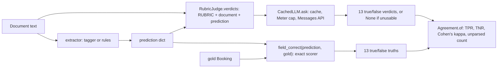

PR: [bhavya94/llm-vs-small-models-extraction#7](https://github.com/bhavya94/llm-vs-small-models-extraction/pull/7)

# Stack 7/8: a rubric LLM judge, scored against the exact scorer

## Summary
Real extraction work rarely has gold answers, so teams often let an LLM judge the output. This PR measures how far
such a judge deserves trust. A rubric judge (Claude Haiku 4.5) sees the document and the extraction, never the
gold. It answers true or false for each field. The exact scorer from Stack 2/8 supplies the truth. The PR
reports agreement as true positive rate, true negative rate and Cohen's kappa. Kappa is 0.985 on tagger predictions for
unseen layouts and 0.948 on rules predictions for adversarial documents. The run cost $0.50.

## How it works

- [`src/extraction_eval_lab/evaluation/judge.py:17`](https://github.com/bhavya94/llm-vs-small-models-extraction/blob/1a1a9bde53d30591e05c02515ffe6ff9aef390b9/src/extraction_eval_lab/evaluation/judge.py#L17) is the rubric. It asks for exact values in the schema's formats.
  It also says that a revised, negated or misattributed value is wrong. That line targets the adversarial categories.
- [`src/extraction_eval_lab/evaluation/judge.py:30`](https://github.com/bhavya94/llm-vs-small-models-extraction/blob/1a1a9bde53d30591e05c02515ffe6ff9aef390b9/src/extraction_eval_lab/evaluation/judge.py#L30) builds the judge's input from the document and the prediction only. The judge has no gold parameter.
- [`src/extraction_eval_lab/evaluation/judge.py:36`](https://github.com/bhavya94/llm-vs-small-models-extraction/blob/1a1a9bde53d30591e05c02515ffe6ff9aef390b9/src/extraction_eval_lab/evaluation/judge.py#L36) rejects a reply without exactly the 13 keys and boolean values. That reply counts as unparsed, not as a verdict.
- [`src/extraction_eval_lab/evaluation/judge.py:53`](https://github.com/bhavya94/llm-vs-small-models-extraction/blob/1a1a9bde53d30591e05c02515ffe6ff9aef390b9/src/extraction_eval_lab/evaluation/judge.py#L53) skips unparsed replies and reports their count, so a bad reply cannot hide inside the rates.
- [`src/extraction_eval_lab/evaluation/judge.py:58`](https://github.com/bhavya94/llm-vs-small-models-extraction/blob/1a1a9bde53d30591e05c02515ffe6ff9aef390b9/src/extraction_eval_lab/evaluation/judge.py#L58) to [`judge.py:60`](https://github.com/bhavya94/llm-vs-small-models-extraction/blob/1a1a9bde53d30591e05c02515ffe6ff9aef390b9/src/extraction_eval_lab/evaluation/judge.py#L60) compute TPR over fields the scorer marks right and TNR over fields it marks wrong.
  Kappa comes from `metrics-from-scratch`.
- [`src/extraction_eval_lab/llm/client.py:44`](https://github.com/bhavya94/llm-vs-small-models-extraction/blob/1a1a9bde53d30591e05c02515ffe6ff9aef390b9/src/extraction_eval_lab/llm/client.py#L44) is the new shared `CachedLLM`. This PR moves the cache and the budget out of the extractor, so the judge reuses both.
- [`src/extraction_eval_lab/extractors/llm.py:25`](https://github.com/bhavya94/llm-vs-small-models-extraction/blob/1a1a9bde53d30591e05c02515ffe6ff9aef390b9/src/extraction_eval_lab/extractors/llm.py#L25) keeps only the extraction logic: prompt, validation and repair.
- [`src/extraction_eval_lab/cli.py:140`](https://github.com/bhavya94/llm-vs-small-models-extraction/blob/1a1a9bde53d30591e05c02515ffe6ff9aef390b9/src/extraction_eval_lab/cli.py#L140) picks two prediction sources. [`cli.py:148`](https://github.com/bhavya94/llm-vs-small-models-extraction/blob/1a1a9bde53d30591e05c02515ffe6ff9aef390b9/src/extraction_eval_lab/cli.py#L148) scores them with the exact scorer and [`cli.py:149`](https://github.com/bhavya94/llm-vs-small-models-extraction/blob/1a1a9bde53d30591e05c02515ffe6ff9aef390b9/src/extraction_eval_lab/cli.py#L149) with the judge.
- [`pyproject.toml:33`](https://github.com/bhavya94/llm-vs-small-models-extraction/blob/1a1a9bde53d30591e05c02515ffe6ff9aef390b9/pyproject.toml#L33) pins `metrics-from-scratch` to one commit, so the kappa code cannot change under the results. Earlier PRs used the unpinned git URL.
- [`tests/test_layers.py:9`](https://github.com/bhavya94/llm-vs-small-models-extraction/blob/1a1a9bde53d30591e05c02515ffe6ff9aef390b9/tests/test_layers.py#L9) adds the `llm` package as a bottom layer that both extractors and evaluation may import.

## Results
| Predictions | Fields | Scorer says right | TPR | TNR | Kappa |
|---|---|---|---|---|---|
| tagger, unseen layouts | 1300 | 52% | 0.999 | 0.986 | 0.985 |
| rules, adversarial | 2600 | 88% | 0.994 | 0.950 | 0.948 |

The judge returned a usable reply every time (0 unparsed).

The two sources test different things. The tagger on unseen layouts gets 48% of fields wrong, so it tests whether
the judge catches plain errors. The rules on adversarial documents make subtle errors, such as a stale headcount
or a decoy amount. Those test whether the judge reads context. TNR drops from 0.986 to 0.950 there. The judge misses about 1 wrong field in 20 when the error needs context.

## Decision log
| Decision | Options considered | Chosen | Why |
|---|---|---|---|
| Judge output | One score per document; one verdict per field | Per field | Field verdicts line up with the exact scorer, field by field |
| Gold access | Show gold; hide gold | Hide gold | A judge is useful only where gold is missing. Showing gold would measure a different task |
| Agreement metric | Accuracy; TPR and TNR; kappa | TPR, TNR and kappa | Accuracy hides a judge that accepts everything when most fields are right. Kappa corrects for chance |
| Unusable replies | Count as false; skip and count | Skip and count | Treating them as verdicts would mix parse errors with judgment errors |
| LLM plumbing | Copy the cache and budget; share one client | Share `CachedLLM` | One cache and one cap for every paid call |

## Cost & risk
The run makes up to 300 judge calls (100 plus 200 documents) for $0.50, about $0.0017 per document. The default cap
is $2 ([`src/extraction_eval_lab/cli.py:204`](https://github.com/bhavya94/llm-vs-small-models-extraction/blob/1a1a9bde53d30591e05c02515ffe6ff9aef390b9/src/extraction_eval_lab/cli.py#L204)). The cache makes a rerun free. A high kappa here holds for this
schema and these error types. It does not prove the judge is safe on a new schema without the same check.

## Open questions
- If the judge returns no usable reply, `Agreement.of` builds empty arrays, and `~actual` fails on a float array ([`src/extraction_eval_lab/evaluation/judge.py:54`](https://github.com/bhavya94/llm-vs-small-models-extraction/blob/1a1a9bde53d30591e05c02515ffe6ff9aef390b9/src/extraction_eval_lab/evaluation/judge.py#L54) to [`judge.py:56`](https://github.com/bhavya94/llm-vs-small-models-extraction/blob/1a1a9bde53d30591e05c02515ffe6ff9aef390b9/src/extraction_eval_lab/evaluation/judge.py#L56)). Should it return NaN instead?
- The rubric and the scorer differ on leniency. The scorer ignores case and accepts "1700" for "1700.00". The rubric asks for "exactly" what the document states. Some disagreements may come from that gap, not from judgment.
- Should the judge run on SFT and LLM predictions too? This PR judges only the two free extractors.
