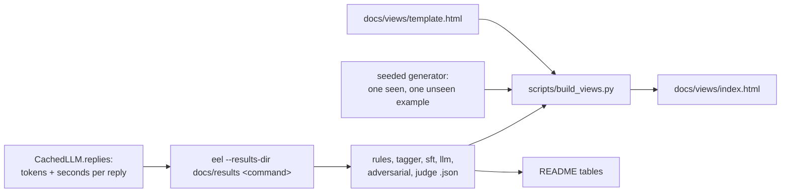

PR: [bhavya94/llm-vs-small-models-extraction#8](https://github.com/bhavya94/llm-vs-small-models-extraction/pull/8)

# Stack 8/8: saved results, the results page and the README

## Summary
This PR turns seven experiments into one readable result. Each `eel` command can now save its numbers as JSON.
The results page and the README tables come from those files, so the page never reruns a model. The PR also
adds the last missing measure: cost and speed per document for each extractor. The headline: only the LLM
handles layouts and edits it never saw, at $1.61 per 1,000 documents and 1.7 seconds per call.

## How it works

- [`src/extraction_eval_lab/cli.py:22`](https://github.com/bhavya94/llm-vs-small-models-extraction/blob/51f717d5c56c83d3ab489ae9ee28229a152ff38b/src/extraction_eval_lab/cli.py#L22) writes a command's numbers only when `--results-dir` is set. A plain run
  prints and saves nothing.
- [`src/extraction_eval_lab/cli.py:29`](https://github.com/bhavya94/llm-vs-small-models-extraction/blob/51f717d5c56c83d3ab489ae9ee28229a152ff38b/src/extraction_eval_lab/cli.py#L29) times each extractor over its documents. Seconds per document are
  wall-clock time on this laptop.
- [`src/extraction_eval_lab/llm/client.py:62`](https://github.com/bhavya94/llm-vs-small-models-extraction/blob/51f717d5c56c83d3ab489ae9ee28229a152ff38b/src/extraction_eval_lab/llm/client.py#L62) logs tokens and seconds for every reply, cache hits included. A
  cached rerun still knows what the replies cost.
- [`src/extraction_eval_lab/llm/client.py:80`](https://github.com/bhavya94/llm-vs-small-models-extraction/blob/51f717d5c56c83d3ab489ae9ee28229a152ff38b/src/extraction_eval_lab/llm/client.py#L80) prices those replies as if the cache were empty. That number is
  the real cost per document.
- [`src/extraction_eval_lab/cli.py:179`](https://github.com/bhavya94/llm-vs-small-models-extraction/blob/51f717d5c56c83d3ab489ae9ee28229a152ff38b/src/extraction_eval_lab/cli.py#L179) takes LLM latency from the adversarial run's live calls. The `llm`
  command's replies came from the cache, which held no latency then.
- [`scripts/build_views.py:21`](https://github.com/bhavya94/llm-vs-small-models-extraction/blob/51f717d5c56c83d3ab489ae9ee28229a152ff38b/scripts/build_views.py#L21) adds one seen and one unseen example document to the page data. A reader sees
  the task before any score.
- [`tests/test_llm.py:75`](https://github.com/bhavya94/llm-vs-small-models-extraction/blob/51f717d5c56c83d3ab489ae9ee28229a152ff38b/tests/test_llm.py#L75) checks that cost and latency survive a cached rerun.
- [`tests/test_views.py:18`](https://github.com/bhavya94/llm-vs-small-models-extraction/blob/51f717d5c56c83d3ab489ae9ee28229a152ff38b/tests/test_views.py#L18) fails when the committed page differs from a fresh build.

## Results
| Extractor | API $ per 1k docs | Seconds per doc | Exact match, unseen | Adversarial, all fields right |
|---|---|---|---|---|
| Rules | 0.00 | 0.0001 | 0% | 8% |
| Tagger | 0.00 | 0.02 | 0% | 2% |
| SFT | 0.00 | 4.43 | 0% | 30% |
| LLM | 1.61 | 1.70 | 100% | 100% |

The tagger runs on the M1's GPU (MPS). The SFT model runs on its CPU in float32. The LLM's seconds are the
median API round trip over 40 live calls.

## Decision log
| Decision | Options considered | Chosen | Why |
|---|---|---|---|
| Page data | Rerun models at build time; read saved JSON | Saved JSON | The page builds in a second, and README and page show the same numbers |
| LLM cost | Dollars spent this run; tokens priced from every reply | Every reply | A cached rerun spends $0, which says nothing about the real cost |
| LLM latency | Time cached replies; record seconds on live calls | Live calls | A cache hit takes microseconds, so timing it would mislead |
| Latency source | Clear the cache and pay again; use the adversarial run's live calls | Adversarial run | No extra spend, and 40 calls give a stable median |
| Page order | Results first; task, method and scores first | Task first | A newcomer needs the task and the scores before any table |

## Cost & risk
Building the page costs nothing. Rerunning every command with a warm cache takes about an hour, mostly the SFT
model's 400 test generations on the CPU. With an empty cache, the paid commands cost about $0.88 in total.

## Open questions
- The adversarial set no longer separates the LLM from a perfect score. A harder set is the natural next step.
- Latency for the local models depends on this laptop. A GPU server would change the speed column, not the
  accuracy columns.
